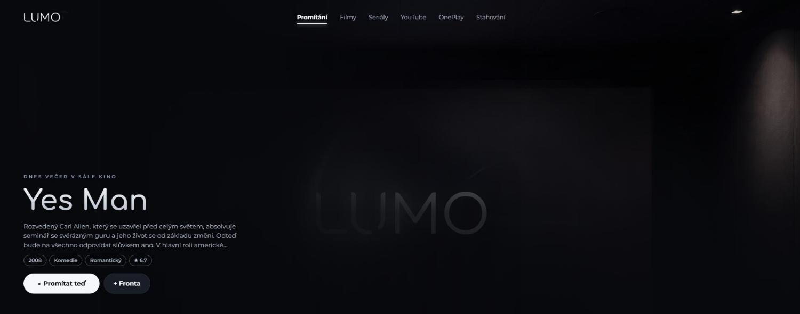
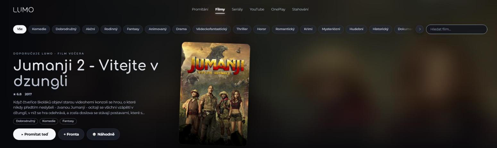
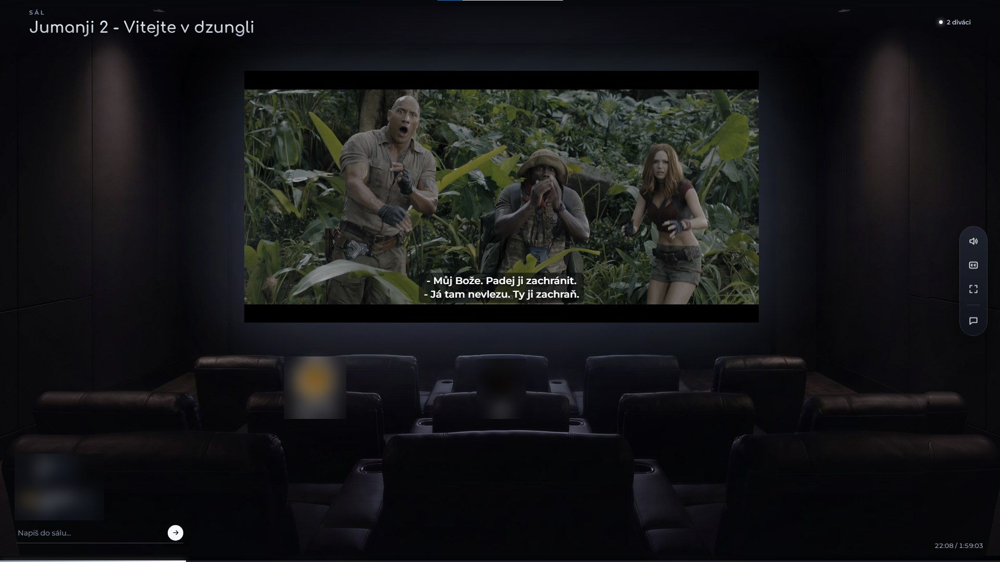
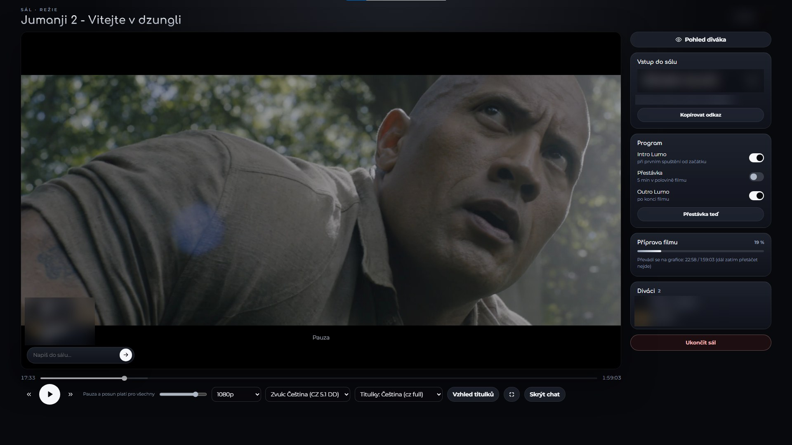

<h3 align="center">Lumo — a private home cinema controlled from Discord and the web</h3>

  
  
  
  

> **Source code is private.** This repository is a short project showcase.

## What it is

Lumo turns my home PC into a small private cinema for me and a few friends. Films, series and YouTube can be started from a Discord panel, from a web app on any device, or by voice. Friends can also watch a film together online in a virtual cinema hall.

## Highlights

- **Discord control panel**: everything is done with buttons, no commands.
- **Web app** with Discord login and a custom video player (HLS).
- **Cinema hall**: synced playback for everyone, chat, and each viewer picks their own quality.
- **Voice control**: works offline with faster-whisper.
- **Runs 24/7** with a watchdog and automatic restart.

About 20,000 lines of code in Python and JavaScript.

## Screenshots

| Home | Catalog |
|---|---|
|  |  |
| **Cinema hall** | **Host controls** |
|  |  |

## Tech

Python · asyncio · discord.py · aiohttp · FFmpeg (GPU) · HLS · JavaScript · WebSockets

---

All rights reserved. Built with AI-assisted development (Claude Code).
